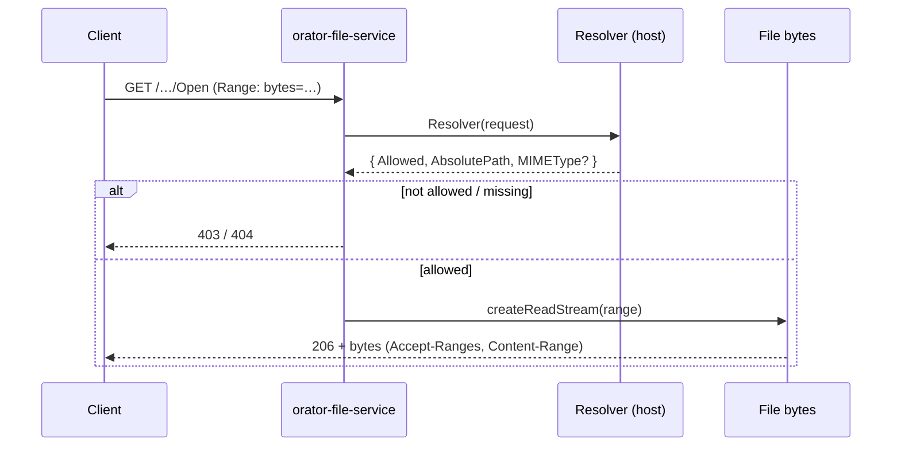
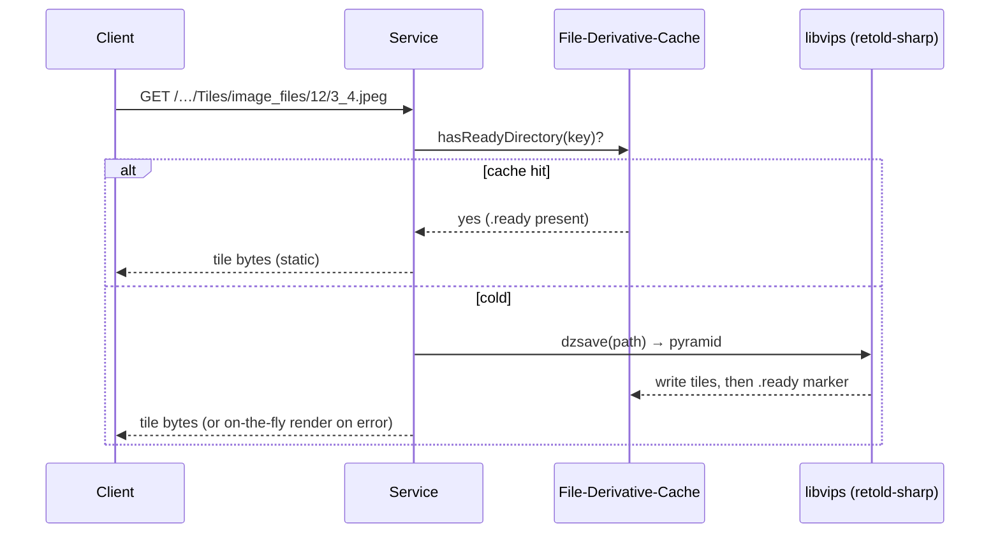

# Architecture

## Overview

`orator-file-service` is a reusable [Orator](https://fable-retold.github.io/orator/) service (it extends
`fable-serviceproviderbase`) that does two jobs behind one **resolver seam**:

1. **HTTP Range (206) byte serving** — stream any file with `Accept-Ranges` / `Content-Range`, so clients
   (`pict-section-fileview`, a `<video>`/`<audio>` element, a PDF viewer) can seek without downloading the whole
   file.
2. **Deep Zoom (DZI) tiling** — turn an enormous image into a libvips tile pyramid (via `retold-sharp`), cache it,
   and serve the tiles, so an 800 MB image opens in a browser that could never blit it into an ``.

The service owns **no identity and no auth**. The host supplies a `Resolver` that maps an incoming request to an
absolute path (and an allow/deny decision) — so tenancy stays in the application layer, exactly where it belongs.

## Building blocks

The main service composes three independently-usable modules (each exported for standalone use):

```mermaid
flowchart TD
    OFS[Orator-File-Service &#40;routes + resolver&#41;] --> FRS[File-Range-Server]
    OFS --> FTS[File-Tile-Service]
    FTS --> FDC[File-Derivative-Cache]
    FRS -.->|"planByteRange / serveFile"| HTTP1[&lt;file bytes, 200 / 206 / 416&gt;]
    FTS -.->|"libvips dzsave"| HTTP2[&lt;DZI descriptor + tiles&gt;]
    FDC -.->|"mtime + variant key, .ready marker"| DISK[(derivative cache on disk)]
```



| Module | Responsibility |
|---|---|
| `File-Range-Server` | Pure `planByteRange(size, rangeHeader)` + streaming `serveFile()` — 200 / 206 / 416 / HEAD, with `Accept-Ranges`, `Content-Range`, `Content-Type`, `Content-Disposition`. |
| `File-Tile-Service` | Pure DZI geometry (`describePyramid`, `tileRegion`, `dziDescriptorXML`) + `ensurePyramid()` (libvips `dzsave`) + on-the-fly `renderTile()`. |
| `File-Derivative-Cache` | An `mtime + variant` md5 key, a 2-char shard fan-out, and a `.ready` marker so a partial `dzsave` is never served as a hit. |

## The resolver seam

Every route handler calls the host's resolver first. The resolver is the **only** place identity, tenancy, and
path mapping live:

```javascript
addFileRoute({
    Route: '/1.0/Depot/File/:id/Open',
    Resolver: (request, callback) =>
    {
        // the host checks auth/tenancy and maps the id to a path
        callback(null, { Allowed: true, AbsolutePath: '/data/…/file.bin', MIMEType: 'video/mp4' });
    },
    EnableTiles: true
});
```



## Tiling — pre-bake cache + on-the-fly fallback

A tile request resolves to a path, then asks `File-Tile-Service` for the pyramid. The default strategy **pre-bakes**
the whole pyramid once with libvips `dzsave` (streamed, bounded memory, no full decode), caches it keyed by the
source file's `mtime` + the tile variant, and serves tiles **statically** from the cache directory thereafter. If
the bake fails or is unavailable, it falls back to rendering the requested tile **on the fly**. Tiling is
capability-gated: when libvips (`retold-sharp`) is not installed, tile routes return a clean `501`.



## Why this shape

- **Bounded memory at any scale** — libvips streams the decode and writes tiles incrementally, so an 800 MB image
  never has to fit in RAM, and the browser only ever fetches the handful of tiles in view.
- **Reusable** — Sluice, `retold-remote`, and `pict-section-fileview` all share one serving contract instead of
  re-implementing Range + tiling per app.
- **Tenancy-safe** — the resolver is the single choke point for identity and path mapping; the service is a dumb,
  reusable byte-and-tile pump.
